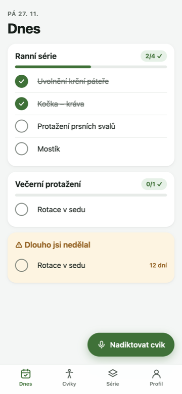
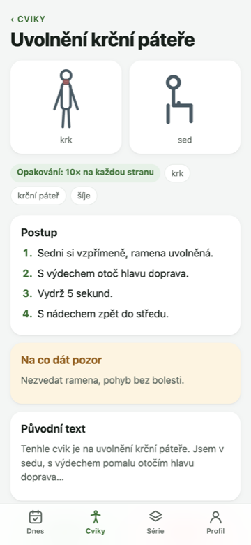
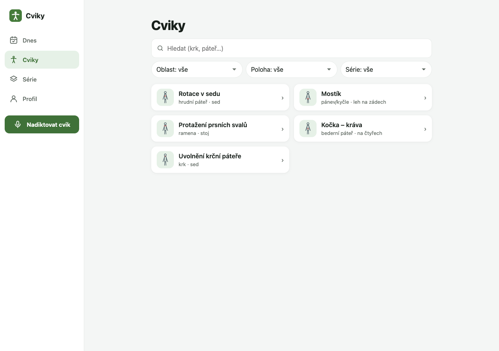

# Cviky

**Never forget your physiotherapy exercises again.** After a session you dictate each exercise into your phone; an LLM turns it into a clean exercise card, you group cards into routines, and the app reminds you every day — including the exercises you have quietly stopped doing.

A small Czech-language PWA built for iPhone (add to Home Screen), also usable on tablets and computers. Live at [cviky.romanzdk.com](https://cviky.romanzdk.com) (invite-only).

<p>
  
  
</p>


## Features

- **Dictate, don't type** — speak the exercise in your own words with the iPhone keyboard microphone. An LLM (via OpenRouter, zero data retention) extracts title, body area, position, tags with synonyms, steps, cautions and repetitions. Your original words are always kept, and the card still saves if the LLM fails.
- **Routines** — group exercises into series with weekdays, a reminder time and an order.
- **Today** — today's series with a progress bar and one-tap check-off, plus a *“long time no see”* card for exercises not done for N days (default 7).
- **Push reminders** — Web Push to the home-screen app, at most once per series per day, skipped when everything is done.
- **Search** — diacritic-insensitive full text over titles, steps, the original dictated text, tags and body-area / position names (`pater` finds *páteř*).
- **Clean UI** — hand-written CSS, light and automatic dark mode, bottom tab bar on phones, sidebar on wide screens.
- **Invite-only accounts** — invites are one-time links created in the admin.

## Tech stack

Django 6 · Python 3.14 · PostgreSQL (`unaccent`) · server-rendered templates, no JS framework · Web Push (VAPID, `pywebpush`) · OpenRouter LLM (`httpx`, JSON schema output) · uv · pytest · ruff · Docker · Caddy · GitHub Actions → GHCR → SSH deploy.

## Run locally

Requires Python 3.14, [uv](https://docs.astral.sh/uv/) and a local PostgreSQL.

```sh
createdb fyzio_cviky
uv sync
uv run python manage.py migrate
uv run python manage.py createsuperuser
uv run python manage.py runserver          # http://localhost:8000
```

The database comes from `DATABASE_URL` (default `postgres:///fyzio_cviky`). Without `OPENROUTER_API_KEY` dictation falls back to an empty card you fill in by hand; without `VAPID_*` keys no reminders are sent.

Create an invite at `/sprava/` → *Invites* → *Add*, or:

```sh
uv run python manage.py shell -c "from cviky.models import Invite; print(Invite.objects.create().token)"
```

## Tests

```sh
uv run pytest -q
uv run ruff check .
```

## Configuration

| Variable | Purpose |
|---|---|
| `DJANGO_DEBUG` | `0` in production |
| `DJANGO_SECRET_KEY` | required when debug is off |
| `DJANGO_ALLOWED_HOSTS`, `DJANGO_CSRF_TRUSTED_ORIGINS` | comma-separated hosts / origins |
| `DATABASE_URL` | PostgreSQL connection |
| `OPENROUTER_API_KEY`, `OPENROUTER_MODEL` | LLM for structuring dictated text |
| `VAPID_PUBLIC_KEY`, `VAPID_PRIVATE_KEY` | Web Push keys |
| `WEB_CONCURRENCY` | gunicorn workers (default `2` in the Docker image) |
| `DJANGO_INSECURE_COOKIES` | `1` drops the `Secure` cookie flag and the proxy HTTPS header (local runs with debug off, without HTTPS) |
| `VAPID_SUBJECT` | `mailto:` contact; required when debug is off (Apple rejects pushes without a real one) |

## Deployment and operations

Production runs with `deploy/docker-compose.yml` (web, reminder scheduler, Postgres) behind Caddy; every push to `main` is tested, built and deployed by `.github/workflows/ci.yml`. The full operations runbook — deploy by hand, roll back, backups, troubleshooting, moving to a new server, removing the app — is in [docs/provoz.md](docs/provoz.md) (Czech).

## License

[MIT](LICENSE)
